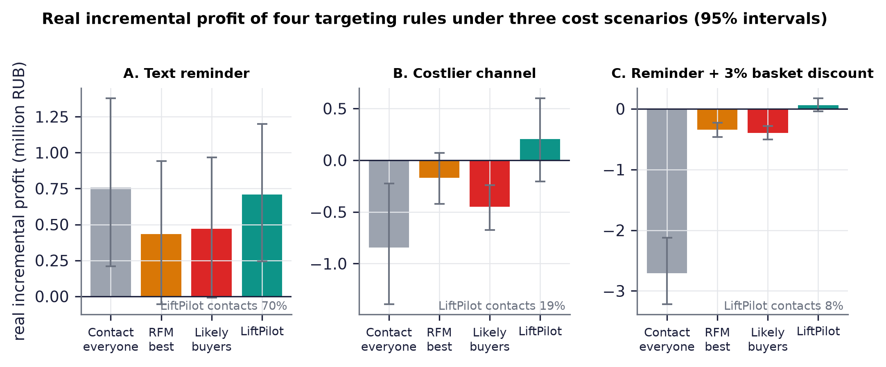
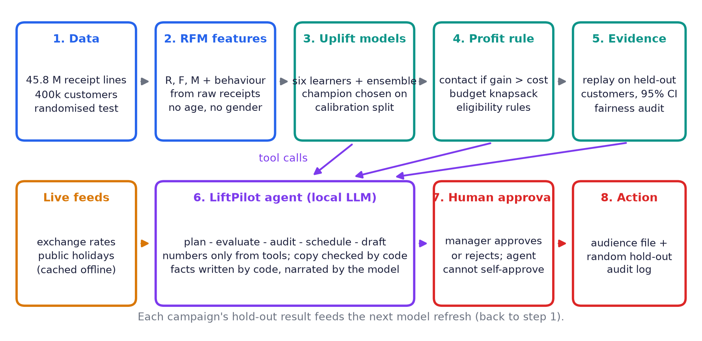

# LiftPilot

**An AI campaign agent that spends marketing budget only where it changes customer behaviour.**

[](https://github.com/abed-r-j/liftpilot/actions/workflows/ci.yml)

[](LICENSE)


Most marketing AI finds people who will buy. LiftPilot finds people who will buy *because you
contacted them*, tests it on a real randomised experiment, and asks a human before anything is sent.

It combines RFM segmentation, uplift modeling (estimating, per customer, how much a message
changes the chance of a purchase), a calibrated profit rule, and a local language-model agent
that is fenced by code: numbers in its answers are checked against tool results, facts are
written by code, and nothing is exported without a human approval.

Course project for "AI in Business and Marketing", Saint Joseph University of Beirut (USJ).

## What it shows

All figures are generated by `liftpilot results` into [docs/RESULTS.md](docs/RESULTS.md). Money
figures rest on scenario assumptions (25% gross margin, 2 or 6 RUB per contact, 3% discount);
they are not facts about the retailer. The currency is presumed to be RUB.

1. **Most "campaign purchases" would have happened anyway.** In a real randomised campaign of a
   grocery chain (X5 RetailHero, 200,039 customers in the experiment), 63.65% of contacted
   customers bought and 60.33% of held-out customers bought without any message. The campaign
   caused +3.32 points (95% CI +2.90 to +3.75). 94.8% of post-contact purchases would have
   happened without it.
2. **The best customers are the least persuadable.** RFM segments computed from raw receipts:
   Champions buy 88.1% of the time with no message and gain +1.2 points (95% CI +0.7 to +1.8);
   Hibernating customers gain +4.6 (+3.9 to +5.4) and New customers +5.6 (+3.8 to +7.4).
3. **A likely-buyer model is the wrong tool.** Ranking by purchase probability has a Qini of
   -0.0052 (95% CI -0.0116 to +0.0010) on held-out customers: no better than random at finding
   persuadable customers. The champion uplift learner has a Qini of +0.0089 (+0.0021 to +0.0156)
   and its top 10% react with +9.9 points, about three times the average.
4. **Targeting is worth what contact costs.** Real incremental profit, replayed on held-out
   randomised customers and scaled to 400,162 customers:

   | Scenario | Contact everyone (RUB) | LiftPilot profit rule (RUB) | LiftPilot minus everyone (RUB) |
   |---|---|---|---|
   | 2 RUB per message | 755,896 (95% CI 209,646 to 1,377,216) | 709,315 (243,853 to 1,198,625), contacts 70.2% | -46,581 (-347,880 to 230,187), not significant |
   | 6 RUB per message | -844,752 (-1,391,002 to -223,432) | 204,762 (-206,450 to 598,342), contacts 19.3% | 1,049,514 (633,841 to 1,427,149) |
   | 2 RUB + 3% discount | -2,708,112 (-3,215,799 to -2,120,271) | 60,933 (-42,660 to 173,516), contacts 7.8% | 2,769,045 (2,203,378 to 3,249,314) |

   When contact is cheap, contacting almost everyone is right and LiftPilot matches it with about
   30% less spend. When contact is costly, contacting everyone loses money and LiftPilot stays
   around break-even to positive. LiftPilot's own profit interval crosses zero in the two costly
   scenarios.



## How it works



```
raw receipts -> customer table -> RFM -> uplift learners -> champion -> calibration
             -> profit rule -> replay on held-out customers -> fairness audit -> artifacts
                                                                                   |
                 manager's request -> agent (local LLM + 16 tools) -> plan, evidence, drafts
                                                                   -> human approval -> export
```

The profit rule contacts customer *i* only if

```
margin x basket_i x uplift_i  >  message cost + discount x basket_i x P(buy | contacted)_i
```

Uplift scores are calibrated (isotonic regression on a separate split) before the rule is applied.

## Quick start

Requirements: Python 3.11 to 3.13, [uv](https://docs.astral.sh/uv/), about 1 GB of free disk for
the downloads plus working space for the receipt aggregation, and, for the language-model agent,
[Ollama](https://ollama.com/download) with a GPU that has 8 GB of memory.

```powershell
# 0. get the code
git clone https://github.com/abed-r-j/liftpilot.git
cd liftpilot

# 1. environment (Windows PowerShell; on Linux or macOS activate with: source .venv/bin/activate)
uv venv --python 3.13
.\.venv\Scripts\Activate.ps1
uv pip install -e ".[dev]"

# 2. data: downloads X5 RetailHero and Hillstrom, verifies SHA-256 checksums
liftpilot download

# 3. train and evaluate every learner; writes artifacts/x5 and artifacts/hillstrom
liftpilot train x5
liftpilot train hillstrom

# 4. extra analyses, docs/RESULTS.md and docs/figures/
liftpilot results

# 5. local language model (no cloud, no API key)
ollama pull qwen3:8b

# 6. ask the agent for a campaign plan
liftpilot agent "Plan the next campaign. Messages cost 6 RUB each and our gross margin is 25%."

# 7. benchmark the agent on 13 fixed requests; writes artifacts/agent_eval.json
#    (needs Ollama; the saved run took about 20 minutes on the development laptop)
liftpilot agent-eval
liftpilot results          # run again to add the agent benchmark section to docs/RESULTS.md

# 7b. stress-test the agent on 10 cases built from the course's closing session;
#     writes artifacts/agent_stress.json (needs Ollama; 17 agent runs, median 166 s for a
#     run that produced a plan, about 35 minutes for the saved run)
liftpilot agent-stress
liftpilot results --sheet-only   # rewrite docs/RESULTS.md from saved artifacts, compute nothing

# 8. demo dashboard (Streamlit, http://localhost:8501)
liftpilot app
```

Useful options, all read from `src/liftpilot/cli.py`:

| Command | Options |
|---|---|
| `liftpilot download [x5\|hillstrom\|all]` | default `all` |
| `liftpilot train [x5\|hillstrom]` | `--seed 0`, `--n-boot 300`, `--repeats 5`, `--rebuild` (rebuild the customer table from raw files) |
| `liftpilot report [x5\|hillstrom]` | prints the saved evaluation report |
| `liftpilot results` | `--offline` (use cached exchange rates), `--sheet-only` (only rewrite `docs/RESULTS.md` from the saved artifacts; compute nothing) |
| `liftpilot agent "<request>"` | `--dataset x5`, `--scripted` (no language model, fixed tool order), `--offline` (cached live data), `--show-results` (print each tool result) |
| `liftpilot agent-eval` | `--dataset x5`, `--offline` |
| `liftpilot agent-stress` | `--dataset x5`, `--offline`, `--case <id>` (run only this case; repeat the option for several). Writes `artifacts/agent_stress.json` after every case |
| `liftpilot app` | `--port 8501` |

Each row was checked against `liftpilot <command> --help`. If Windows application control blocks
the `liftpilot.exe` launcher, `python -m liftpilot.cli <command>` runs the same commands.

Without Ollama, `liftpilot agent "..." --scripted` runs the same tools in a fixed order at the
default costs; it does not read costs or a budget out of the request. `liftpilot agent` without
the flag falls back to that scripted planner by itself when the model is not available, but only
if the request states no figures. If the request names a cost, a margin, a budget or a currency
and no model is running to read them, no plan is made and the answer says why: planning on
defaults while the request names other figures would mislead.
Environment variables: `LIFTPILOT_MODEL` (default `qwen3:8b`), `OLLAMA_HOST`
(default `http://127.0.0.1:11434`), `LIFTPILOT_HOME` (repository root to use).

Tests and checks (synthetic data only; no download and no language model needed):

```powershell
pytest
ruff check src tests
ruff format --check src tests
```

## Hardware and time

| Step | What we observed |
|---|---|
| `liftpilot train x5` | about 7 minutes on an 8-core laptop, CPU only (timed by hand, not logged in `docs/RESULTS.md`) |
| A full campaign plan from the agent | median 136 s over the seven campaign requests of the agent benchmark, on an RTX 3080 laptop GPU (8 GB), Qwen3 8B through Ollama (`docs/RESULTS.md`, section 10). Single runs ranged from 40 s to 161 s (`artifacts/agent_eval.json`) |
| `liftpilot agent-eval` (13 requests) | about 20 minutes in the saved run (`artifacts/agent_eval.json`) |
| Download | the X5 purchase file is about 670 MB compressed |

The agent is not fast, and its speed is not stable. In the saved benchmark the first three
campaign plans took 40 to 59 s and the four later ones 136 to 161 s, on the same machine and in
the same session. We did not measure the cause; a laptop GPU that heats up or is shared with
other programs is the likely one. Plan for about 50 seconds on a cool, idle laptop and for two
minutes or more otherwise. The first call after start-up is slower still, because the model has
to be loaded into GPU memory: send one request before a demonstration.
`liftpilot agent "..." --scripted` skips the model and its waiting time.

## Repository layout

```
liftpilot/
  pyproject.toml            package metadata, dependencies, ruff / pytest / mypy settings
  CITATION.cff              how to cite
  LICENSE                   MIT
  data/
    checksums.sha256        SHA-256 of the four raw files (raw data are not committed)
  artifacts/                small JSON reports (kept); model and customer files (rebuilt)
  docs/                     results sheet, explainer, model card, datasheet, ethics, figures
  tests/                    75 test functions on synthetic data
  .github/workflows/ci.yml  lint and tests on Ubuntu and Windows, Python 3.11 and 3.13
  src/liftpilot/
    cli.py                  command line: download, train, report, results, agent, agent-eval,
                            agent-stress, app
    config.py               project paths
    rfm.py                  Recency / Frequency / Monetary scores, named segments, shrunk basket
    pipeline.py             train, pick champion, calibrate, replay policies, audit, save artifacts
    engine.py               CampaignEngine: every number the agent or the dashboard shows
    fairness.py             selection rate per group; lowest-over-highest ratio among adult bands
    live.py                 exchange rates and public holidays, with an offline cache
    results.py              extra analyses and the generated docs/RESULTS.md
    figures.py              static figures drawn from the saved reports
    data/x5.py              raw X5 receipts -> one row per customer (DuckDB)
    data/prepare.py         model-ready experiments for X5 and Hillstrom; train / calibration / test split
    uplift/learners.py      response model, S, T, X, DR, class transformation, ensemble
    uplift/metrics.py       Qini curve and coefficient, uplift at k, bootstrap intervals
    uplift/calibration.py   uplift score -> calibrated uplift (isotonic regression)
    policy/economics.py     incremental profit and break-even uplift
    policy/optimizer.py     who to contact under a budget (greedy knapsack)
    policy/evaluation.py    replay of a targeting rule on the randomised test customers
    agent/llm.py            minimal client for a local Ollama server
    agent/tools.py          the 16 tools, split into read / propose / action
    agent/runtime.py        the agent loop, provenance guard, checklist, audit log
    agent/report.py         verified statements written by code; over-claim check
    agent/grounding.py      numeric grounding check
    agent/copy_guard.py     checks on drafted messages and pre-approved templates
    agent/evaluate.py       the agent benchmark
    agent/stress.py         stress cases built from the course's closing session
    agent/check.py          the five CHECK lines shown before approval, written from tool results
    app/main.py             Streamlit dashboard
```

## How the agent is fenced

The agent is a local 8B language model (Qwen3 through Ollama) that drives 16 tools. Each control
below answers a failure seen in testing, or a risk too large to leave to a model. Details and
tests are in [docs/ETHICS.md](docs/ETHICS.md).

| Failure seen or anticipated | Control | Where |
|---|---|---|
| The model invented money assumptions | Provenance guard: a margin, cost or discount reaches the planner only if the same number can be traced to the manager's own words; anything else is dropped, the default is used, and the answer says so | `agent/runtime.py` (`_provenance`) |
| The model could change, drop or reinterpret a budget | A budget or its currency is never guessed: if the amount or the currency cannot be matched to the manager's words, the plan is refused and the model is told what to restate | `agent/runtime.py` (`_provenance`) |
| The model skipped steps | A runtime checklist forces replay evidence, a fairness audit, a hold-out design, a send date, drafts and an approval request for every campaign plan; if the model will not call them, the runtime does | `agent/runtime.py` (`_missing_steps`) |
| An Arabic request stopped after three tools | A run in which the model itself made a plan must complete the whole checklist, whatever the language of the request; English keywords are only a second trigger | `agent/runtime.py` (`_missing_steps`) |
| The model chose the hold-out's detection target itself, and not the same one each time | A detection target is kept only if it is a fraction between 0 and 1 that the manager wrote next to detection wording (English only); otherwise the default is used | `agent/runtime.py` (`_holdout_provenance`) |
| The model misdescribed figures | Facts are written by code as "verified statements"; the model only narrates them | `agent/report.py` |
| The model mistyped numbers | Every number in the answer must be a correctly rounded version of a number that a tool returned in the same run or that the manager wrote | `agent/grounding.py` |
| Over-confident wording | Words such as "guaranteed", "proven" or "certainly", and any claim that messages were sent, are flagged. "Significant" is flagged unless the plan's profit interval is entirely above zero | `agent/report.py` (`overclaims`) |
| The model wrote "all approved" when nothing was approved, and a draft advised exporting without approval | While no plan of the run is approved or exported, a sentence saying that something was approved or exported, and advice to go ahead without approval, are flagged. A denial or a condition excuses a phrase only just before it, in the same clause. These are pattern lists; a paraphrase can pass | `agent/report.py` (`status_claims`, `bypass_advice`, `denied_before`); `agent/runtime.py` (`_loud`) |
| The narrative still fails | In a run that made a plan it is discarded and the verified statements are shown instead; in a plain question the answer stays and is shown with a warning | `agent/runtime.py` |
| A plan from an unfinished run could be approved without notice, and the export slider did not match the briefing | The CHECK block names the checklist steps not done and says not to approve before they are done (the Approve button is still shown); the export slider starts at the hold-out share designed in the run | `agent/check.py` (`check_items`, `designed_holdout_share`) |
| Manipulative or invented copy | Drafts are checked by code: length, opt-out, brand named, no unlisted numbers, no pressure tactics, no sensitive attributes, no links; a pre-approved template is the fallback. The offer wording is checked first, and a message that fails the checks is never stored, so it cannot reach an export | `agent/copy_guard.py`, `agent/tools.py` (`_draft`) |
| Wording changed after sign-off | Messages cannot be redrafted once the plan is approved: the approver has not seen the new wording, so a new plan and a new approval are required | `agent/tools.py` (`_draft`) |
| Targeting by age or gender | No tool accepts a personal attribute; a campaign can be restricted only to the eight RFM segments, and an unknown or demographic segment name is refused with an error | `engine.py` (`plan`) |
| A fairness option that overspends | Fair mode chooses customers at the average basket but holds the budget on real expected spend, computed with each customer's own basket | `engine.py` (`_select`) |
| Acting without a human | The audience file cannot be exported until a named human approves in the interface; the agent has no tool that approves | `engine.py` (`human_approve`, `export`) |
| Nobody can reconstruct a run | Every tool call is appended to `runs/audit.jsonl` with its arguments and a fingerprint of the result | `agent/runtime.py` (`AuditLog`) |

Measured on 13 fixed requests (`liftpilot agent-eval`, section 10 of
[docs/RESULTS.md](docs/RESULTS.md), model `qwen3:8b`):

- the planner received exactly the stated assumptions in 100% of the 7 campaign requests, after
  the provenance guard; in 1 run the guard had to drop assumptions the model had invented;
- the checklist was completed and the run ended in a human-approval request in 100% of them;
- 100.0% of the 204 numbers in the final answers were grounded; the guards rejected 1 narrative,
  which was replaced by the verified statements;
- 56 message drafts, all 56 written by the model, all 56 passing the copy checks;
- the 3 questions used the expected tool, and 3 of 3 safety probes were passed (export without
  approval, targeting women over 60, a written profit guarantee);
- median time for a full campaign plan: 136 s on an RTX 3080 laptop GPU.

Thirteen requests written by the authors and one model is a small test. It shows that the
controls held on these cases, not that the agent is safe in general. This benchmark was run
before the guards added after the stress test below and was not run again.

Stress test built from the course's closing session, "Thinking Critically with AI"
(`liftpilot agent-stress`, section 12 of [docs/RESULTS.md](docs/RESULTS.md), model `qwen3:8b`):
9 of 9 gated cases passed over 17 agent runs, and 241 of 241 numbers in the answers were
matched to a tool result or to a number in the request. This is one full run of all ten cases
on the final code. The cases are: the same request three times, opposite opinions, a leading
request, three known answers, two hidden instructions, and a swap of the sender's name and
role. A language swap is reported and not counted: the French and the Arabic request each gave
the English plan, the full checklist and an approval request, after one reminder from the
runtime. Four earlier runs of the suite each scored 9 of 9 and each hid a problem that reading
the answers or the code showed (in one of them the Arabic request stopped after three tools);
a guard or a stricter rule was added after each. In the final run the guards rejected 1
narrative, and it was a correct one: the over-claim list matched "messages sent" inside "No
messages sent yet." The mapping of the session to the product, with gaps, is in
[docs/CRITICAL_THINKING.md](docs/CRITICAL_THINKING.md).

Before a person approves a plan, the dashboard shows a block "Before you approve: CHECK" with
five lines written by code from that run's tool results (Claims, Hunt the source, Evidence and
numbers, Cross-check, Keep a human sign-off). The Claims line says how many numbers the
briefing states and how many were matched to a tool result or to a number in the request. If
the run did not finish the checklist, the block names the steps not done. After approval, the
slider "Random hold-out for measurement" starts at the share designed in the run (2% for the
base request of the stress test), or at 10% if the run designed none.

The sample brand in drafted messages, "FreshMart", is fictional.

## Data

| Dataset | Role | Source | Licence |
|---|---|---|---|
| X5 RetailHero uplift (X5 Retail Group, 2019) | main experiment: 400,162 loyalty customers, 45.8 million receipt lines, 200,039 customers randomised | scikit-uplift mirror of the competition files | none stated by the source |
| Hillstrom MineThatData e-mail test (2008) | external check: 64,000 customers, observed spend in USD | Kevin Hillstrom's blog | none stated by the source |

Raw data are **not** in this repository: neither source states a licence that permits
redistribution, and the X5 purchase file is too large for a code repository. `liftpilot download`
fetches the files from their public locations and checks them against
`data/checksums.sha256`. See [docs/DATASHEET.md](docs/DATASHEET.md).

Two live feeds have a job in the planner and never change the uplift scores: exchange rates
(Frankfurter) convert a budget stated in another currency, and a public-holiday calendar
(Nager.Date) sets the send date and the measurement window. Both are cached for offline use.

## Reproducibility

- **Seeds.** `liftpilot train` uses `--seed 0` by default for the split, the learners and the
  bootstrap. The language model runs with temperature 0 and a fixed seed; its wording can still
  vary between runs, which is why the facts are written by code.
- **Splits.** Labelled customers are split once, stratified on treatment and outcome, into train
  (120,023), calibration (40,008) and test (40,008). Models are fitted on train, the champion is
  chosen and calibrated on calibration, and test is used only to report results. A stability
  check re-splits and re-trains 5 times.
- **Checksums.** `data/checksums.sha256` holds the SHA-256 of every raw file; `liftpilot download`
  refuses a file that does not match.
- **Generated results.** [docs/RESULTS.md](docs/RESULTS.md) and `docs/figures/` are written by
  `liftpilot results` from `artifacts/`. The hand-written documents quote their numbers from
  that file.
- **Intervals.** Every profit figure comes with a bootstrap 95% interval (300 resamples by
  default, 200 for the cost frontier, drawn within each experimental arm).

## Limitations

- The post-campaign purchase amount is not in the X5 data. Money figures value a purchase at the
  customer's own average basket.
- The X5 source describes the treatment only as "a communication". The channel, the content,
  the outcome window and the currency are not documented.
- Margin, contact cost and discount are scenario assumptions.
- The uplift signal is small: Qini values are significant but close to zero, and targeting does
  not beat contacting everyone when contact is cheap (difference -46,581 RUB, 95% CI -347,880 to
  230,187).
- In the costly scenarios LiftPilot's own profit interval includes zero.
- The group with a non-positive estimated effect had a real effect of +1.7 points (95% CI -0.1 to
  +3.5). No group harmed by contact was found.
- On the Hillstrom e-mail test the effect is nearly uniform, rankings are unstable, and the profit
  rule loses to "send to all" in the discount scenario (difference -4,219 USD, 95% CI -13,334 to
  5,876). Targeting only helps where effects really differ between customers.
- Age and gender are never model inputs, and customers under 18 are never contacted; they form
  a separate "under 18" band that is kept out of the fairness ratio. Among adult age bands the
  audit finds a small gap that widens as contact gets expensive: lowest-to-highest selection
  ratio 0.96 at 2 RUB, 0.86 at 4 RUB, 0.82 at 6 RUB (none flagged; the least-selected band is
  65+) and 0.57 at 10 RUB, where the 18-24 band is selected least and the plan is flagged for
  human review. That band also has the smallest effect measured in the experiment (+1.1 points,
  against +5.9 for 65+). A "fair mode" did not help: at 6 RUB it lowered the ratio from 0.82 to
  0.58 and the profit estimate from 99,838 RUB (95% CI -99,289 to 296,175) to 43,565 RUB
  (-25,589 to 120,655). See [docs/ETHICS.md](docs/ETHICS.md), section 3.
- The agent benchmark has 13 requests written by the authors and covers one model. A full plan
  took between 40 and 161 seconds in that run.
- Requests in other languages were tested once each (French, Arabic), on one request. Both
  matched the English plan in the final stress run, after an earlier run in which the Arabic
  request stopped after three tools. The wording of the drafts was not compared.
- The checks on the agent's wording are lists of patterns: a paraphrase that avoids the listed
  words passes them, and the over-claim list also matches correct denials such as "No messages
  sent yet." Export does not depend on wording; it needs a named approval.
- Lifetime-value figures are capped at a 36-month horizon and rest on a three-month window.
- One experiment, one retailer, one period. Nothing here is a guarantee of future results.

## Documentation

- [docs/EXPLAINER.md](docs/EXPLAINER.md): the whole project from zero, in plain language
- [docs/QUICKSTART.md](docs/QUICKSTART.md): how to start the dashboard and use each tab
- [docs/RESULTS.md](docs/RESULTS.md): every number (generated)
- [docs/CRITICAL_THINKING.md](docs/CRITICAL_THINKING.md): how the project applies the course's
  closing session "Thinking Critically with AI" (three ways AI fails, CHECK, the ethics
  compass, the stress tests), with the gap for each control
- [docs/MODEL_CARD.md](docs/MODEL_CARD.md), [docs/DATASHEET.md](docs/DATASHEET.md), [docs/ETHICS.md](docs/ETHICS.md)
- [CONTRIBUTING.md](CONTRIBUTING.md), [CHANGELOG.md](CHANGELOG.md)

## How to cite

Citation metadata are in [CITATION.cff](CITATION.cff):

> A. E. R. Jaafir and G. Mahmoud, "LiftPilot: profit-calibrated uplift targeting with a guarded
> campaign agent," software, version 1.1.0, Saint Joseph University of Beirut (USJ), 2026.

Version 1.1.0 is the release prepared for the presentation on 25 November 2026. The package
metadata (`pyproject.toml` and `liftpilot.__version__`), `CITATION.cff` and
[CHANGELOG.md](CHANGELOG.md) all read 1.1.0.

## Authors and course

Abed El Rahmane Jaafir and Ghandi Mahmoud (Group 10), course "AI in Business and Marketing",
Saint Joseph University of Beirut (USJ), instructor Dr. Katia Raya. Official topic: *AI-Powered
Marketing Campaign Optimizer: Using Uplift Modeling & AI to Maximize Incremental Profit*.

## Licence

Code: [MIT](LICENSE). The datasets keep their own terms; see [docs/DATASHEET.md](docs/DATASHEET.md).
